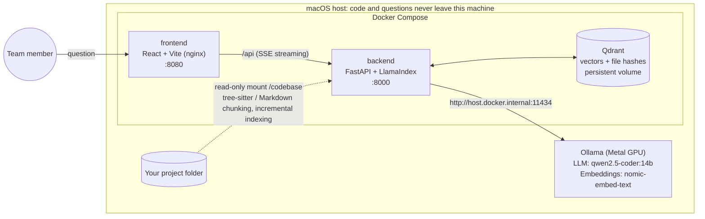
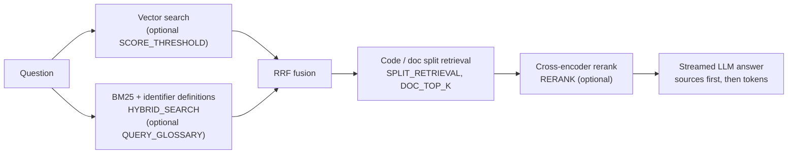

# local-codebase-rag

[](https://github.com/alelcold/local-codebase-rag/actions/workflows/ci.yml)
[](LICENSE)
[](https://codespaces.new/alelcold/local-codebase-rag?quickstart=1)

[繁體中文](README.md) · **English**

An on-premises RAG assistant that answers natural-language questions about a game front-end codebase, citing **file paths and line ranges** (for example `src/entities/Player.ts:16-113`) so every answer can be checked against the source. The LLM, the embedding model and the vector database all run on your own machine: no code and no question leaves it.

<!-- TODO: add a screenshot or GIF here (a streamed answer with citations on the sample project), e.g. docs/assets/demo.gif -->

## Contents

- [The problem](#the-problem)
- [Highlights](#highlights)
- [Decisions made with data](#decisions-made-with-data)
- [Quick start](#quick-start)
- [How this was built](#how-this-was-built)
- [Documentation](#documentation)

## The problem

In a game front-end codebase, the most common questions are "where is this value set?" and "which files does this flow go through?". New team members find the answers by grepping and asking people, and company code usually cannot be pasted into a cloud AI service.

This project turns "ask the codebase" into an internal team tool:

- **Code stays on the machine**: the LLM and the embedding model run in Ollama on the Mac. There is no cloud API and the per-query API cost is zero ([ADR 0001](docs/decisions/0001-on-prem-rag-over-cloud-api.md)).
- **Answers can be verified**: every answer cites `file:line`, so you check the code instead of trusting the model.
- **Tuned with data**: every retrieval change is a `.env` switch, off by default in the backend, and is adopted only after automated evaluation runs on a fixed question set (see [Decisions made with data](#decisions-made-with-data)). Only split code/doc retrieval (`SPLIT_RETRIEVAL`, `DOC_TOP_K=1`) was adopted, and only in the Codespaces template `.env.codespaces` ([ADR 0018](docs/decisions/0018-codespaces-default-retrieval-settings.md)).



What one query goes through in the backend (everything except vector search is a `.env` switch, off by default in the backend; the Codespaces template turns on only `SPLIT_RETRIEVAL`, [ADR 0018](docs/decisions/0018-codespaces-default-retrieval-settings.md)):



## Highlights

| Highlight | How | Details |
| --- | --- | --- |
| **On-prem privacy** | Ollama runs natively on macOS to use the Metal GPU (Docker on a Mac cannot); Qdrant, backend and frontend run in Docker. The frontend binds to localhost by default; the backend and Qdrant always do | [ADR 0001](docs/decisions/0001-on-prem-rag-over-cloud-api.md), [0002](docs/decisions/0002-ollama-outside-docker-on-mac.md) |
| **Streaming answers** | `POST /query/stream` (SSE): sources as soon as retrieval finishes, then the answer token by token, with a heartbeat every 10 s when idle so forwarding proxies that cut silent connections at about 100 s keep it open; nginx does not buffer the stream | [ADR 0010](docs/decisions/0010-streaming-responses.md) |
| **Hybrid and split retrieval** | Vector + BM25 + identifier-definition matching, merged with RRF; code and docs retrieved separately so docs cannot crowd out code; plus a similarity threshold, a cross-encoder reranker and a query glossary (Chinese term → identifier). All are switches, off by default; after the experiments only split retrieval went into the Codespaces template | [ADR 0013](docs/decisions/0013-hybrid-retrieval-and-split-retrieval.md), [0014](docs/decisions/0014-similarity-threshold.md), [0015](docs/decisions/0015-rerank.md), [0018](docs/decisions/0018-codespaces-default-retrieval-settings.md), [0020](docs/decisions/0020-query-glossary-instead-of-chinese-word-segmentation.md) |
| **Syntax-aware chunking, incremental indexing** | tree-sitter chunks per function / class (oversized classes split per method), Markdown per heading; incremental indexing by content hash, with an automatic full rebuild when chunking settings change | [ADR 0004](docs/decisions/0004-chunking-by-file-type.md) |
| **Automated evaluation** | `evaluate.py` runs 10 main + 5 identifier questions and measures latency, cited-file hits, defining-file hits, Simplified-character drift and trick-question refusals; `compare.py` diffs two runs; `calibrate_threshold.py` calibrates the threshold from results; `benchmark-mac.sh` runs the whole Mac benchmark in one command | [ADR 0012](docs/decisions/0012-automated-evaluation-metrics.md), [0017](docs/decisions/0017-one-command-mac-benchmark.md), [experiment plan](docs/evaluation/experiment-plan-retrieval.md) |
| **CI** | GitHub Actions: ruff lint, unit tests (Ollama and Qdrant faked; 200 tests in about 7 s), compose validation, image builds, and an end-to-end smoke test on PRs into `main` (Ollama on the runner with `qwen2.5-coder:0.5b`) | [ADR 0008](docs/decisions/0008-ci-design.md), [metrics §6](docs/metrics.md#6-engineering-quality) |
| **Dev container** | Opening a GitHub Codespace installs Ollama, pulls the models, starts the stack and indexes the sample project; `scripts/doctor.sh` runs 12 checks in order and prints the fix for each failure | [ADR 0011](docs/decisions/0011-devcontainer-for-codespaces.md) |

## Decisions made with data

Every retrieval change was compared one switch at a time on GitHub Codespaces (CPU, `qwen2.5-coder:3b`, `TOP_K=4`) with a fixed question set before deciding whether to adopt it; each group ran once. The numbers come from [`docs/metrics.md` §4a / §4c](docs/metrics.md#4a-retrieval-switches-adr-0013), [devlog 2026-11-03](docs/devlog/2026-11-03.md) and [devlog 2026-11-05](docs/devlog/2026-11-05.md). Correctness was scored 0–2 per answer against the source by AI (Claude); a person re-checked only the 5 least certain scores. The two question sets total 30 points ([ADR 0018](docs/decisions/0018-codespaces-default-retrieval-settings.md)).

**Outcome (ADR 0018)**: the Codespaces template `.env.codespaces` turns on only `SPLIT_RETRIEVAL=true`, `DOC_TOP_K=1` (`PROMPT_VARIANT=v1`). Hybrid search, rerank, chunk metadata, the similarity threshold and prompts v2 / v3 are not adopted and stay off. `QUERY_GLOSSARY` is implemented but not yet evaluated (group K) and is off. The Mac's `.env.example` is unchanged until the Mac benchmark runs.

| Problem | Experiment | Result | Decision |
| --- | --- | --- | --- |
| "Where is X set?" questions retrieve almost only docs | A baseline → C split retrieval (`DOC_TOP_K=1`) | Docs among retrieved chunks **95% → 25%**; main set "code file retrieved" **1/9 → 6/9**; correctness **11 → 17** (/30), with no loss on Q2, Q3, Q6 whose facts live in docs | **Adopted** in `.env.codespaces` (Mac pending) |
| Questions naming an identifier (`INVINCIBLE_MS`) miss its definition | A → B hybrid search | Identifier set "defining file retrieved" **1/3 → 3/3** at 0.07–0.21 s retrieval; but C alone also reaches 3/3, and D (hybrid + split) scores 16 < C's 17, pushing out main-set Q8 | Not adopted: nothing on top of split retrieval; stays optional |
| Trick questions (features that do not exist) should get "not found" | Calibrate `SCORE_THRESHOLD` from A and C results | Median cosine of relevant vs. irrelevant excerpts is nearly the same (0.616 vs 0.604); the common 0.70 would drop **25/27 (93%)** of excerpts that should be retrieved, and 0.50 already drops 2/27 | **No threshold**; group G not run ([calibration](docs/evaluation/results/2026-11-03-threshold-calibration.md)) |
| Can a general reranker bring the defining code up? | H rerank only; D → I rerank on top of hybrid + split | H: main-set defining file still **0/3**, docs 85%; `bge-reranker-base` scores Markdown 0.8–0.99 and code mostly < 0.1. I: defining file 0/3 → 3/3, but the code it brings up scores only 0.0027; rerank adds **4.8 s** per query and first-token time D → I grows by **9.6 s** (17.2 → 26.8 s); correctness 17/30, the same as C | Not adopted: costly, answers no better; C + rerank not yet tested |
| Chunk metadata and prompt v2 | F (C + hybrid + metadata + v2) | Defining file 0/3 (C: 1/3), still 2 answers with Simplified characters; correctness 16/30 (C: 17); changing metadata requires a full re-index | Not adopted |
| Anti-hallucination prompt v3 | J (D + v3), plus the out-of-scope set | Trick questions refused **5/5**, but **8/9** answerable main-set questions falsely refused; correctness 8/30 | **Not adopted** (false refusals must be 0, [ADR 0016](docs/decisions/0016-refuse-out-of-scope-questions-in-the-prompt.md)) |
| Group B's first token looks twice as fast (6.7 vs 13.0 s) | Per-question JSON comparison | 7/10 questions retrieved exactly the same excerpts as A, 3 of them with a first token at about 0.2 s: Ollama's prompt cache, not hybrid search | Latency comparisons annotated; `benchmark-mac.sh` unloads the model before each evaluation |
| Chinese questions have no identifiers for BM25 to match (Q2 scored 0 in all 8 groups) | `QUERY_GLOSSARY`: Chinese term → identifier ([ADR 0020](docs/decisions/0020-query-glossary-instead-of-chinese-word-segmentation.md)) | Offline check only (keyword and identifier channels; glossary written by someone who had seen the questions, so an upper bound): expected code files in the top 4 go from 3/19 → 16/19. End-to-end group K not yet run | Implemented, off by default; **group K not yet run** |

The same comparison on a Mac M2 with `qwen2.5-coder:14b` has not been measured yet; [`scripts/benchmark-mac.sh`](scripts/benchmark-mac.sh) produces it in one command ([ADR 0017](docs/decisions/0017-one-command-mac-benchmark.md)).

**Scope**: the design target is projects of about 50–300 files; every experiment above ran on the 20-file, 67-chunk sample project, once per group. On a larger project, re-evaluate with your own question set (procedure in the [guide, 專案規模與擴展](docs/guide.md#專案規模與擴展), in Chinese).

## Quick start

### Try it in GitHub Codespaces (nothing to install)

Click **Open in GitHub Codespaces** above (4-core machine recommended). The dev container installs Ollama, pulls the models, starts the stack and indexes the sample project; then open port 8080 from the **Ports** panel. Codespaces is CPU-only and uses `qwen2.5-coder:3b`, so speed and answer quality do not represent the Mac. If something fails, run `./scripts/doctor.sh`: it checks each step in order and prints the fix.

### Install on a Mac

You need an Apple Silicon Mac (target: M2, 32 GB; with 16 GB use `qwen2.5-coder:7b`), [Ollama](https://ollama.com/download) and [Docker Desktop](https://www.docker.com/products/docker-desktop/).

```bash
brew install ollama
git clone https://github.com/alelcold/local-codebase-rag.git
cd local-codebase-rag
cp .env.example .env          # indexes the bundled sample project; set PROJECT_PATH for your own
./scripts/setup.sh --index    # checks Ollama, pulls models, docker compose up, builds the index
```

Open <http://localhost:8080> and try (the sample questions are in Chinese, but English works too and gets an English answer):

- 玩家受傷後的無敵時間在哪裡設定？ (Where is the invincibility time after the player is hit set?)
- How are the score and the combo multiplier calculated?
- How does the asteroid spawn rate change with the level?

Indexing, configuration, the API, troubleshooting and scaling to larger projects are covered in the **[operations guide (docs/guide.md)](docs/guide.md)** (Traditional Chinese).

## How this was built

Most of the code was written by Claude Code (an AI coding agent). The first version (backend, UI, Docker, setup script, 50 unit tests) came out of one cloud session for about USD 7; all sessions up to 2026-11-05 total about USD 100 ([metrics §1](docs/metrics.md)).

My part:

- **Constraints and architecture**: code must not leave the machine, Ollama stays out of Docker on a Mac, and one Compose setup must run on a Mac, GitHub Codespaces and Linux GPU machines.
- **Verification in real environments**: the failures that passed every unit test but broke deployments were found and traced by running the stack on Codespaces (for example the 504 from the port forwarder at about 100 s, [ADR 0009](docs/decisions/0009-timeout-settings.md), [0010](docs/decisions/0010-streaming-responses.md)).
- **Experiments and decisions**: build the evaluation tooling first, change one switch at a time, and set defaults from the data.

The working rules are in [`CLAUDE.md`](CLAUDE.md): every significant decision gets an ADR, problems go into the devlog as Problem → Cause → Fix, unmeasured numbers are never filled in, and every demonstration uses only the sample project.

## Documentation

Every document under `docs/` is English first, Traditional Chinese below, except the operations guide.

| Document | Contents |
| --- | --- |
| [docs/guide.md](docs/guide.md) | Operations guide (Chinese): hardware, install, indexing, querying, API, configuration, troubleshooting, Mac benchmark, Codespaces, development and tests, repository layout |
| [docs/decisions/](docs/decisions/README.md) | 20 architecture decision records (ADRs) |
| [docs/devlog/](docs/devlog/) | Development log: problems as Problem → Cause → Fix, with exact error messages |
| [docs/metrics.md](docs/metrics.md) | Cost, indexing, latency, evaluation results, model comparison |
| [docs/evaluation/](docs/evaluation/README.md) | Question sets, how to run `evaluate.py`, the [retrieval experiment plan](docs/evaluation/experiment-plan-retrieval.md) and the [raw results](docs/evaluation/results/README.md) |
| [CLAUDE.md](CLAUDE.md) | Project brief and working rules for the AI agent (decision records, bilingual docs, privacy) |

## License

[MIT](LICENSE)
