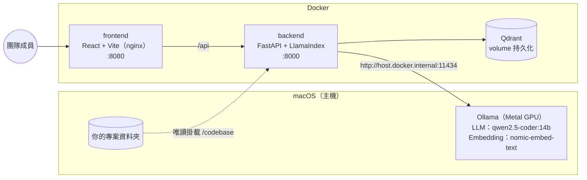

# local-codebase-rag

地端版的 Codebase RAG 系統：讓團隊用自然語言查詢遊戲前端專案的程式碼（適合約 50–300 個檔案的專案）。
所有資料與模型都在本機執行，程式碼不會離開你的電腦。

回答會附上引用的**檔案路徑與行號**，例如 `src/entities/Player.ts:16-113`，點開即可看到對應的程式碼。



## 目錄

- [硬體需求](#硬體需求)
- [為什麼 Ollama 不放在 Docker 裡](#為什麼-ollama-不放在-docker-裡)
- [安裝步驟](#安裝步驟)
- [如何索引專案](#如何索引專案)
- [如何查詢](#如何查詢)
- [設定](#設定)
- [常見問題](#常見問題)
- [開發與測試](#開發與測試)
- [專案結構](#專案結構)
- [文件導覽](#文件導覽)

## 硬體需求

| 項目 | 建議 | 說明 |
| --- | --- | --- |
| 電腦 | Apple Silicon Mac（M2 以上） | 本專案以 Mac M2、32GB RAM 為目標環境 |
| 記憶體 | 32GB | `qwen2.5-coder:14b`（Q4）加上 16K 上下文約佔 12–13GB 統一記憶體；embedding 模型約 0.3GB；Docker（Qdrant + 後端）約 1–2GB |
| 磁碟 | 15GB 以上可用空間 | 14b 模型約 9GB、embedding 模型約 0.3GB、Docker 映像約 1.5GB，向量資料通常不到 100MB |
| 軟體 | macOS 13+、[Ollama](https://ollama.com/download)、[Docker Desktop](https://www.docker.com/products/docker-desktop/)（含 Compose v2） | |

記憶體較少（例如 16GB）時，建議把 `LLM_MODEL` 改成 `qwen2.5-coder:7b`，並把 `LLM_NUM_CTX` 降到 `8192`。

Docker Desktop 不需要分配很多記憶體（預設值即可），因為最吃記憶體的模型是跑在 macOS 上，不在 Docker 的 VM 裡。

## 為什麼 Ollama 不放在 Docker 裡

**一句話：Docker 裡的 Ollama 用不到 Mac 的 GPU。**

1. **Docker 在 macOS 上是跑在 Linux 虛擬機裡**，容器看不到 Apple 的 Metal GPU。Ollama 在容器內只能用 CPU 推論，14b 模型的生成速度會慢好幾倍，查詢一次可能要等好幾分鐘。直接安裝在 macOS 上的 Ollama 會自動使用 Metal 加速。
2. **記憶體配置更有效率**。Apple Silicon 是 CPU/GPU 共用的統一記憶體。如果模型放在 Docker VM 裡，就得先把一大塊記憶體固定劃給 VM；原生執行時，macOS 可以依實際需要動態分配。
3. **模型檔只需要下載一次**。原生 Ollama 的模型存在 `~/.ollama`，其他工具（例如 IDE 外掛、終端機 `ollama run`）也能共用，重建容器也不會重新下載 9GB 的模型。

因此架構上把「需要 GPU 的部分」（Ollama）放在主機，「容易打包的部分」（Qdrant、後端、前端）放在 Docker。
容器透過 Docker Desktop 提供的 `host.docker.internal` 連到主機的 Ollama（`http://host.docker.internal:11434`）。

## 安裝步驟

### 1. 安裝 Ollama 與 Docker Desktop

```bash
brew install ollama
```

或從 <https://ollama.com/download> 下載 macOS App（安裝後開啟一次，它會常駐在選單列）。
Docker Desktop 請從 <https://www.docker.com/products/docker-desktop/> 下載安裝並啟動。

### 2. 取得本專案並設定

```bash
git clone https://github.com/alelcold/local-codebase-rag.git
```

```bash
cd local-codebase-rag
```

```bash
cp .env.example .env
```

編輯 `.env`，把 `PROJECT_PATH` 改成要索引的專案路徑（第一次想先試流程的話可以保留預設的範例專案）：

```dotenv
PROJECT_PATH=/Users/you/work/my-game-frontend
```

### 3. 執行安裝腳本

```bash
./scripts/setup.sh --index
```

這個腳本會依序：

1. 確認 Ollama 已安裝；沒有在執行的話會試著啟動它
2. 拉取 `LLM_MODEL` 與 `EMBED_MODEL`（已存在就略過；第一次下載 14b 模型需要一段時間）
3. 確認 Docker 正在執行、`PROJECT_PATH` 存在
4. `docker compose up -d --build` 啟動 Qdrant、後端、前端
5. 等後端健康檢查通過
6. （加上 `--index` 時）建立索引

其他參數：`--skip-pull`（不檢查模型）、`--no-build`（不重新 build 映像）、`--help`。

### 4. 開始使用

打開 <http://localhost:8080>，右上角的狀態標籤是綠色就表示 Ollama、Qdrant 都正常。

### 先用範例專案測試流程

`examples/sample-game-frontend/` 是一個小型的遊戲前端專案（約 20 個檔案，TypeScript + React + Markdown 文件），
`.env` 的預設值就是它。執行 `./scripts/setup.sh --index` 之後，可以在介面上試著問：

- 玩家受傷後的無敵時間在哪裡設定？
- 分數和連擊倍率是怎麼計算的？
- 遊戲主迴圈的流程是什麼？
- 小行星的生成頻率怎麼隨關卡變化？

確認流程沒問題後，再把 `PROJECT_PATH` 改成你的專案（見下方「換成自己的專案」）。

## 如何索引專案

### 執行索引

三種方式效果相同，擇一即可：

| 方式 | 增量索引 | 完整重建 |
| --- | --- | --- |
| 網頁介面 | 按「更新索引」 | 按「完整重建」 |
| 命令列（會即時顯示每個檔案的進度） | `./scripts/index.sh` | `./scripts/index.sh --full` |
| API | `curl -X POST localhost:8000/index` | `curl -X POST localhost:8000/index -H 'Content-Type: application/json' -d '{"full": true}'` |

- **增量索引**（預設）：只處理新增、修改、刪除的檔案。每個檔案的內容雜湊值存在 Qdrant 裡，沒變的檔案會直接略過，不會重新呼叫 embedding 模型。專案改動後隨時執行即可，幾秒內就會完成。
- **完整重建**：清空目前的 collection 後重新處理所有檔案。一般不需要；當你懷疑索引有問題時再用。

修改 `CHUNK_MAX_CHARS` 之後，增量索引會自動判斷所有檔案都需要重新切塊。更換 `EMBED_MODEL` 會自動改用另一個 collection（例如 `codebase_mxbai_embed_large`），因此也只需要執行一次增量索引。

API 的 `/index` 預設在背景執行並立即回傳，可用 `GET /index/status` 查看進度；若要等待完成再回傳，加上 `"wait": true`。

### 會索引哪些檔案

- 副檔名：預設 `.ts .tsx .js .jsx .mjs .cjs .md`（`INDEX_EXTENSIONS`）
- 略過的資料夾：`node_modules`、`.git`、`dist`、`build`、`coverage`、`.next` 等（`EXCLUDE_DIRS`）
- 略過的檔名：`*.min.js`、`*.map`、`*.d.ts`、`package-lock.json` 等（`EXCLUDE_PATTERNS`）
- 超過 500KB 的檔案會略過（`MAX_FILE_BYTES`），通常是打包產物或自動產生的資料

專案以**唯讀**方式掛載到容器的 `/codebase`，索引器不會修改你的任何檔案。

### 切塊方式

| 檔案類型 | 切法 |
| --- | --- |
| `.ts` `.tsx` `.js` `.jsx` `.mjs` `.cjs` | 用 tree-sitter 解析語法樹，每個頂層 function、class、interface、type、enum、`const X = () => …` 元件各成一塊；上方的 JSDoc 註解會跟著同一塊。`import` 與其他頂層敘述合併成 module 區塊。超過 `CHUNK_MAX_CHARS` 的 class 會再依 method 切開（`Game.update`、`Game.render`…） |
| `.md` | 依標題（`#`～`######`）切成章節，程式碼區塊裡的 `#` 不會被當成標題；每塊會記錄標題路徑，例如 `玩法規則 > 計分` |
| 其他（若加入 `INDEX_EXTENSIONS`） | 依固定行數切塊 |

每一塊都保留原始的起訖行號；送進 embedding 模型時會加上「檔案路徑＋符號名稱」的標頭，讓「Player 的 jump 在哪」這類問題更容易命中。

### 換成自己的專案

1. 修改 `.env` 的 `PROJECT_PATH`
2. 如果之後還想保留其他專案的索引，順便設定 `QDRANT_COLLECTION=my_game`（每個專案用不同名稱）
3. 重新建立後端容器讓新的掛載生效，然後建立索引：

```bash
docker compose up -d
```

```bash
./scripts/index.sh
```

若沒有設定不同的 `QDRANT_COLLECTION`，舊專案的檔案會在這次增量索引中被視為「已刪除」並從索引移除。

## 如何查詢

### 網頁介面

在 <http://localhost:8080> 輸入問題，按「送出」或 ⌘/Ctrl + Enter。

- 回答中的 `[1]`、`[2]` 可以點擊，會捲到對應的引用片段並展開
- 每個引用片段顯示 `檔案路徑:起始行-結束行`、符號名稱（函式或 class）與相似度分數，展開後可看到帶行號的程式碼
- 「參考片段」可以調整要給模型看幾段程式碼（預設 8）。問題範圍較大時調高，模型回答會比較完整，但會稍慢

第一次查詢需要把模型載入記憶體，可能要 20–60 秒；之後模型會常駐 `OLLAMA_KEEP_ALIVE`（預設 30 分鐘），查詢通常在十幾秒內完成，實際速度視機型（M2 / Pro / Max）與回答長度而定。

### 提問技巧

- 直接提到你知道的名稱效果最好：「`ScoreSystem` 的連擊什麼時候歸零？」
- 問「在哪裡」「怎麼運作」「流程是什麼」這類問題最適合；需要全專案統計的問題（例如「總共有幾個元件」）不適合 RAG，因為模型只看得到取回的片段
- 回答只根據取回的程式碼產生。如果回答說找不到，可以換個說法、提高參考片段數，或確認檔案有被索引
- 中英文提問都可以，模型會用提問的語言回答

### API

後端 API 文件（Swagger）：<http://localhost:8000/docs>

```bash
curl -s localhost:8000/query -H 'Content-Type: application/json' \
  -d '{"question": "玩家受傷後的無敵時間在哪裡設定？", "top_k": 6}'
```

回應格式：

```json
{
  "answer": "無敵時間由 INVINCIBLE_MS 控制（1500 毫秒）[1]，在 Player.takeDamage 中設定 [2]……",
  "sources": [
    {
      "ref": 1,
      "file_path": "src/config/gameConfig.ts",
      "start_line": 1,
      "end_line": 26,
      "symbol": "",
      "kind": "module",
      "language": "typescript",
      "score": 0.71,
      "text": "/** Fixed simulation step, in seconds. */\n..."
    }
  ]
}
```

| 端點 | 說明 |
| --- | --- |
| `GET /health` | Ollama（含所需模型是否已下載）與 Qdrant 的狀態、目前索引的片段數 |
| `POST /index` | 開始索引。body：`{"full": false, "wait": false}`；已有索引在執行時回傳 409 |
| `GET /index/status` | 最近一次索引的狀態、進度與結果（新增／更新／刪除的檔案、錯誤） |
| `POST /query` | body：`{"question": "...", "top_k": 8}`；回傳回答與引用來源 |

## 設定

所有設定都在 `.env`，完整清單與說明請見 [`.env.example`](.env.example)。最常調整的幾項：

| 變數 | 預設值 | 說明 |
| --- | --- | --- |
| `PROJECT_PATH` | `./examples/sample-game-frontend` | 要索引的專案（主機路徑，唯讀掛載） |
| `LLM_MODEL` | `qwen2.5-coder:14b` | 回答用的模型 |
| `EMBED_MODEL` | `nomic-embed-text` | 向量化模型 |
| `LLM_NUM_CTX` | `16384` | LLM 上下文長度；太小會截斷引用的程式碼 |
| `TOP_K` | `8` | 預設取回的片段數 |
| `FRONTEND_PORT` / `FRONTEND_BIND` | `8080` / `127.0.0.1` | 前端連接埠；改成 `0.0.0.0` 開放區網存取 |

修改 `.env` 後執行 `docker compose up -d` 讓設定生效（會重新建立有變更的容器）。改了模型名稱記得先 `ollama pull`，或重新執行 `./scripts/setup.sh`。

## 常見問題

### 右上角顯示「Ollama 無法連線」

1. 確認 Ollama 在 Mac 上有執行：

   ```bash
   curl http://localhost:11434/api/version
   ```

2. 確認容器連得到主機的 Ollama：

   ```bash
   docker compose exec backend python -c "import urllib.request; print(urllib.request.urlopen('http://host.docker.internal:11434/api/version').read())"
   ```

3. 使用 Docker Desktop 時，Ollama 預設只監聽 `127.0.0.1` 也能連到。如果你用的是 **Colima、OrbStack 或其他 Docker 實作**而連不到，請讓 Ollama 監聽所有網卡後重新啟動 Ollama：

   ```bash
   launchctl setenv OLLAMA_HOST 0.0.0.0
   ```

   這樣會讓同一個網路上的其他機器也能存取 Ollama，請只在可信任的網路使用。

### 顯示「缺少模型」

`.env` 中的模型還沒下載。執行 `ollama pull <模型名稱>`，或重新執行 `./scripts/setup.sh`。可用 `ollama list` 查看已下載的模型。

### 第一次查詢很慢，或查詢逾時

第一次查詢要把約 9GB 的模型載入記憶體，屬正常現象。之後模型會常駐 `OLLAMA_KEEP_ALIVE` 設定的時間。
如果經常逾時：改用 `qwen2.5-coder:7b`、降低 `LLM_NUM_CTX`、或降低參考片段數；也可以把 `LLM_REQUEST_TIMEOUT` 調高。
可在另一個終端機執行 `ollama ps` 確認模型是否已載入，以及是否 100% 在 GPU 上執行。

### Mac 變得很卡、記憶體壓力很高

把 `LLM_MODEL` 改成 `qwen2.5-coder:7b`，`LLM_NUM_CTX` 降到 `8192`，或把 `OLLAMA_KEEP_ALIVE` 設短一點（例如 `5m`）讓模型閒置時釋放記憶體。

### 回答不準確，或說找不到相關程式碼

- 確認索引是最新的（執行一次增量索引，結果會顯示新增/更新了哪些檔案）
- 展開引用片段，看取回的程式碼是否相關。如果不相關，換個說法或直接提到函式/class 名稱
- 提高「參考片段」數量
- 確認相關檔案的副檔名在 `INDEX_EXTENSIONS` 內，且沒有被 `EXCLUDE_DIRS` / `EXCLUDE_PATTERNS` / `MAX_FILE_BYTES` 排除（索引結果會列出因檔案過大而略過的檔案）
- 可以試試其他 embedding 模型，例如 `EMBED_MODEL=mxbai-embed-large`（`ollama pull` 後執行一次索引即可，會自動使用新的 collection）

### 某些檔案索引失敗

索引結果會列出失敗的檔案與原因，其他檔案不受影響。常見原因是索引過程中 Ollama 被關閉或逾時。
失敗的檔案會保留舊版的索引內容，下次執行增量索引時會自動重試。

### 專案改動後需要重新索引嗎？

需要，但只要執行增量索引（介面上的「更新索引」或 `./scripts/index.sh`），只會處理有變更的檔案。
也可以排程自動執行，例如在 crontab 每小時觸發一次：

```bash
curl -s -X POST localhost:8000/index > /dev/null
```

### 掛載的專案路徑在容器裡是空的

Docker Desktop 只能掛載「Settings → Resources → File sharing」中允許的路徑（預設包含 `/Users`）。
專案放在外接硬碟或其他位置時，請先加入 File sharing，再執行 `docker compose up -d`。

### 讓團隊成員從其他電腦使用

在 `.env` 設定 `FRONTEND_BIND=0.0.0.0` 後執行 `docker compose up -d`，其他人就能用 `http://<你的 Mac 的 IP>:8080` 連線。
本系統沒有登入機制，任何能連到這個連接埠的人都能查詢程式碼，請只在公司內網等可信任的網路開放。
後端 API（8000）與 Qdrant（6333）一律只綁定本機。

### 連接埠被占用

修改 `.env` 的 `FRONTEND_PORT`、`BACKEND_PORT` 或 `QDRANT_PORT`，然後 `docker compose up -d`。

### 如何清除所有索引資料

```bash
docker compose down -v
```

`-v` 會刪除 Qdrant 的 volume。下次啟動後執行索引即可重建。只想重建索引而不刪除 volume 的話，用 `./scripts/index.sh --full`。

### 停止與更新

```bash
docker compose down
```

```bash
git pull && docker compose up -d --build
```

## 開發與測試

### 後端單元測試

測試不需要 Ollama、Qdrant 或 Docker：Ollama 以假的 embedding / LLM 與 mock 的 HTTP transport 取代，Qdrant 使用 qdrant-client 的記憶體模式（`:memory:`）。

```bash
cd backend
```

```bash
python3 -m venv .venv && source .venv/bin/activate
```

```bash
pip install -r requirements-dev.txt
```

```bash
pytest
```

涵蓋範圍：切塊（TS/TSX/JS/Markdown、行號正確性、大型 class 依 method 切分）、增量索引（新增/修改/刪除/未變更、設定變更、embedding 失敗時保留舊資料）、檢索與提示詞組成、API（`/health`、`/index`、`/index/status`、`/query` 的正常與錯誤情況）、設定。

### 不用 Docker 開發

```bash
docker compose up -d qdrant
```

```bash
cd backend && QDRANT_URL=http://localhost:6333 OLLAMA_BASE_URL=http://localhost:11434 CODEBASE_PATH=../examples/sample-game-frontend uvicorn app.main:app --reload
```

```bash
cd frontend && npm install && npm run dev
```

前端開發伺服器（<http://localhost:5173>）會把 `/api` 代理到 `http://localhost:8000`。

## 專案結構

```text
.
├── docker-compose.yml          # qdrant / backend / frontend（Ollama 在主機上）
├── .env.example                # 所有可設定項目與說明
├── scripts/
│   ├── setup.sh                # 檢查 Ollama、拉模型、啟動 compose
│   └── index.sh                # 在容器內執行索引器
├── backend/                    # FastAPI + LlamaIndex
│   ├── Dockerfile
│   ├── app/
│   │   ├── main.py             # API：/health /index /index/status /query
│   │   ├── config.py           # 環境變數設定
│   │   ├── chunker.py          # 依語法結構 / Markdown 標題切塊
│   │   ├── indexer.py          # 增量索引（也可用 python -m app.indexer 執行）
│   │   ├── store.py            # Qdrant 存取
│   │   ├── rag.py              # 檢索與回答（附檔案行號引用）
│   │   └── services.py         # 建立 Ollama / Qdrant 用戶端、健康檢查
│   └── tests/
├── frontend/                   # React + Vite，build 後由 nginx 提供並代理 /api
│   ├── Dockerfile
│   ├── nginx.conf
│   └── src/
└── examples/
    └── sample-game-frontend/   # 測試用的範例專案
```

## 文件導覽

開發過程中的決策、問題與數據都記錄在 `docs/`，之後可用來寫技術文章與更新履歷。所有文件都是英文在前、繁體中文在後。
The `docs/` folder records decisions, problems and measurements made during development. Every document is in English first, with Traditional Chinese below.

| 文件 / Document | 內容 / Contents |
| --- | --- |
| [CLAUDE.md](CLAUDE.md) | 專案簡介、架構，以及記錄決策與隱私的規則 / Project overview, architecture, rules for recording decisions, privacy rules |
| **開發日誌 / Devlog** | |
| [docs/devlog/TEMPLATE.md](docs/devlog/TEMPLATE.md) | 每日開發日誌範本 / Daily devlog template |
| [docs/devlog/2026-10-30.md](docs/devlog/2026-10-30.md) | 架構設計與雲端建置 / Architecture design and cloud build |
| [docs/devlog/2026-11-01.md](docs/devlog/2026-11-01.md) | Codespaces 流程驗證 / Validating the flow on Codespaces |
| **架構決策紀錄 / ADRs** | |
| [docs/decisions/TEMPLATE.md](docs/decisions/TEMPLATE.md) | ADR 範本 / ADR template |
| [0001](docs/decisions/0001-on-prem-rag-over-cloud-api.md) | 採用地端 RAG 而非雲端 API / On-prem RAG instead of a cloud API |
| [0002](docs/decisions/0002-ollama-outside-docker-on-mac.md) | Mac 上 Ollama 不放進 Docker / Ollama outside Docker on Mac |
| [0003](docs/decisions/0003-qdrant-vector-database.md) | 向量資料庫選用 Qdrant / Qdrant as the vector database |
| [0004](docs/decisions/0004-chunking-by-file-type.md) | 依檔案類型切塊 / Chunking by file type |
| [0005](docs/decisions/0005-model-selection-and-hardware.md) | 模型選擇與硬體對應 / Model selection and hardware |
| [0006](docs/decisions/0006-multi-environment-deployment.md) | 多環境部署差異 / Multi-environment deployment |
| **學習與評估 / Learning & evaluation** | |
| [docs/learning/knowledge-checklist.md](docs/learning/knowledge-checklist.md) | 10 個主題的解釋、程式碼位置、面試題、自我檢核 / 10 topics: explanation, code pointers, interview questions, self-check |
| [docs/evaluation/questions.md](docs/evaluation/questions.md) | 範例專案的 10 題評估與計分表 / 10 evaluation questions on the sample project, with a score sheet |
| [docs/metrics.md](docs/metrics.md) | 成本、索引、查詢時間、評估結果、模型比較 / Cost, indexing, latency, evaluation results, model comparison |
| **作品集 / Portfolio** | |
| [docs/portfolio/article-series.md](docs/portfolio/article-series.md) | 5 篇技術文章大綱 / Outlines for 5 technical articles |
| [docs/portfolio/resume.md](docs/portfolio/resume.md) | 履歷條目草稿（中英文）/ Resume bullet drafts (EN and ZH) |
