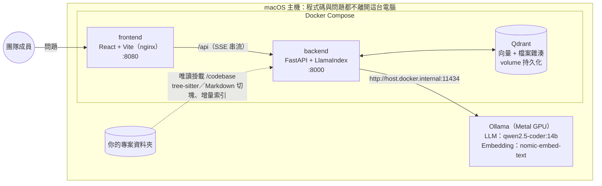
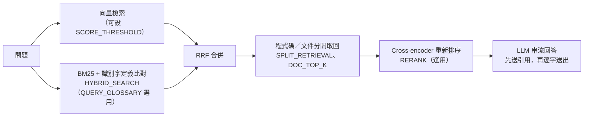

# local-codebase-rag

[](https://github.com/alelcold/local-codebase-rag/actions/workflows/ci.yml)
[](LICENSE)
[](https://codespaces.new/alelcold/local-codebase-rag?quickstart=1)

**繁體中文** · [English](README.en.md)

地端版的 Codebase RAG 系統：讓團隊用自然語言查詢遊戲前端專案的程式碼，回答附上**檔案路徑與行號**引用（例如 `src/entities/Player.ts:16-113`），點開即可核對。LLM、embedding 與向量資料庫都在本機執行，程式碼與問題不會離開你的電腦。

<!-- TODO: 在這裡放一張示範截圖或 GIF（範例專案的串流回答與引用），例如 docs/assets/demo.gif -->

## 目錄

- [解決什麼問題](#解決什麼問題)
- [技術亮點](#技術亮點)
- [用數據做決策](#用數據做決策)
- [快速開始](#快速開始)
- [開發方式](#開發方式)
- [文件導覽](#文件導覽)

## 解決什麼問題

遊戲前端專案裡，最常見的問題是「這個數值在哪裡設定？」「這個流程經過哪些檔案？」。新成員或跨組同事要靠搜尋關鍵字、問人才找得到答案；而公司程式碼通常不能貼到雲端的 AI 服務。

這個專案把「問程式碼」做成團隊內部的工具：

- **程式碼不離開本機**：LLM 與 embedding 模型用 Ollama 在 Mac 上執行，沒有任何雲端 API，每次查詢的 API 成本為零（[ADR 0001](docs/decisions/0001-on-prem-rag-over-cloud-api.md)）。
- **回答可以驗證**：每個回答都附上 `檔案:行號` 引用，點開就能核對，不必相信模型。
- **用數據調整**：檢索方式的每個改動都是 `.env` 開關，後端程式預設全部關閉；用固定題庫跑自動評估後才決定要不要採用（見[用數據做決策](#用數據做決策)）。結論是目前只有分類取回（`SPLIT_RETRIEVAL`、`DOC_TOP_K=1`）採用，而且只寫進 Codespaces 範本 `.env.codespaces`（[ADR 0018](docs/decisions/0018-codespaces-default-retrieval-settings.md)）。



一次查詢在後端經過的步驟（除了向量檢索，其他都是 `.env` 開關。後端程式預設全部關閉；Codespaces 範本只開 `SPLIT_RETRIEVAL`，[ADR 0018](docs/decisions/0018-codespaces-default-retrieval-settings.md)）：



## 技術亮點

| 亮點 | 做法 | 詳細 |
| --- | --- | --- |
| **地端隱私** | Ollama 直接裝在 macOS 上使用 Metal GPU（Docker 在 Mac 上用不到 GPU），Qdrant、後端、前端在 Docker；前端預設只綁定本機，後端與 Qdrant 一律只綁定本機 | [ADR 0001](docs/decisions/0001-on-prem-rag-over-cloud-api.md)、[0002](docs/decisions/0002-ollama-outside-docker-on-mac.md) |
| **串流回應** | `POST /query/stream`（SSE）：檢索完先送引用、再逐 token 送回答，閒置時每 10 秒送 heartbeat，避開轉發代理約 100 秒切斷沒有回應的連線；nginx 對串流路徑關閉緩衝 | [ADR 0010](docs/decisions/0010-streaming-responses.md) |
| **混合檢索與分類取回** | 向量 + BM25 + 識別字定義比對，以 RRF 合併；程式碼與文件分開取回，避免文件擠掉程式碼；另有相似度門檻、cross-encoder rerank 與查詢詞彙表（中文詞 → 識別字）。全部是開關，後端程式預設關閉；實驗後只有分類取回寫進 Codespaces 範本 | [ADR 0013](docs/decisions/0013-hybrid-retrieval-and-split-retrieval.md)、[0014](docs/decisions/0014-similarity-threshold.md)、[0015](docs/decisions/0015-rerank.md)、[0018](docs/decisions/0018-codespaces-default-retrieval-settings.md)、[0020](docs/decisions/0020-query-glossary-instead-of-chinese-word-segmentation.md) |
| **語法感知切塊、增量索引** | tree-sitter 依函式／class 切塊（過大的 class 依 method 再切）、Markdown 依標題切；以內容雜湊做增量索引，切塊設定改變時自動全量重建 | [ADR 0004](docs/decisions/0004-chunking-by-file-type.md) |
| **自動化評估與實驗** | `evaluate.py` 用 10 題主要題組＋5 題識別字題組量測延遲、引用命中、定義檔命中、簡體字、陷阱題拒答；`compare.py` 比較兩次執行；`calibrate_threshold.py` 從結果校準門檻；`benchmark-mac.sh` 一鍵完成 Mac 實測 | [ADR 0012](docs/decisions/0012-automated-evaluation-metrics.md)、[0017](docs/decisions/0017-one-command-mac-benchmark.md)、[實驗計畫](docs/evaluation/experiment-plan-retrieval.md) |
| **CI** | GitHub Actions：ruff lint、單元測試（Ollama、Qdrant 皆以假物件取代，200 個測試約 7 秒）、compose 設定檢查、映像檔 build、對 `main` 的 PR 跑端到端冒煙測試（runner 上的 Ollama + `qwen2.5-coder:0.5b`） | [ADR 0008](docs/decisions/0008-ci-design.md)、[metrics §6](docs/metrics.md#6-engineering-quality) |
| **Dev Container** | 開啟 GitHub Codespace 就自動安裝 Ollama、拉模型、啟動服務、建立索引；`scripts/doctor.sh` 依序做 12 項檢查並印出修正指令 | [ADR 0011](docs/decisions/0011-devcontainer-for-codespaces.md) |

## 用數據做決策

檢索方式的改動都先在 Codespaces（CPU、`qwen2.5-coder:3b`、`TOP_K=4`）用固定題庫逐項比較，再決定要不要採用，每組只跑一次。下面的數字來自 [`docs/metrics.md` §4a／§4c](docs/metrics.md#4a-retrieval-switches-adr-0013)、[devlog 2026-11-03](docs/devlog/2026-11-03.md) 與 [devlog 2026-11-05](docs/devlog/2026-11-05.md)。正確性分數是 AI（Claude）逐題對照原始碼評 0～2 分，只有最不確定的 5 題由人複核，其餘未經人確認；兩個題組共 30 分（[ADR 0018](docs/decisions/0018-codespaces-default-retrieval-settings.md)）。

**最終結論（ADR 0018）**：Codespaces 範本 `.env.codespaces` 只開 `SPLIT_RETRIEVAL=true`、`DOC_TOP_K=1`（`PROMPT_VARIANT=v1`）；混合檢索、Rerank、chunk metadata、相似度門檻、prompt v2／v3 都不採用，維持關閉。`QUERY_GLOSSARY` 已實作但尚未實驗（K 組），預設關閉。Mac 的 `.env.example` 沒有改，等 Mac 實測。

| 問題 | 實驗 | 結果 | 決定 |
| --- | --- | --- | --- |
| 「在哪裡設定」的問題，取回的幾乎都是文件 | A 基準線 → C 分類取回（`DOC_TOP_K=1`） | 取回片段中的文件比例 **95% → 25%**；主要題組「有取回程式碼檔」**1/9 → 6/9**；正確性 **11 → 17**（/30），重點在文件的第 2、3、6 題沒有退步 | **採用**，寫進 `.env.codespaces`（Mac 等實測） |
| 問題直接寫出識別字（`INVINCIBLE_MS`）時找不到定義 | A → B 混合檢索 | 識別字題組「取回定義檔」**1/3 → 3/3**，檢索時間 0.07–0.21 秒；但 C 單獨也是 3/3，D（混合 + 分類）正確性 16 < C 的 17，主要題組還擠掉第 8 題 | 不採用：分類取回之上沒有額外效果，維持選用 |
| 陷阱題（不存在的功能）應該回答「找不到」 | 用 A、C 的結果校準 `SCORE_THRESHOLD` | 相關與不相關片段的 cosine 中位數幾乎相同（0.616 vs 0.604）；常見的 0.70 會丟掉 **25/27（93%）**該取回的片段，0.50 就已經丟掉 2/27 | **不採用門檻**，G 組不執行（[校準輸出](docs/evaluation/results/2026-11-03-threshold-calibration.md)） |
| 通用 reranker 能不能把定義程式碼排上來 | H 只開 rerank；D → I 在混合 + 分類上再加 rerank | H：主要題組定義檔仍 **0/3**、文件比例 85%；`bge-reranker-base` 給 Markdown 0.8–0.99 分、程式碼多半 < 0.1。I：定義檔 0/3 → 3/3，但被排上來的程式碼只有 0.0027 分，每次查詢多 **4.8 秒** rerank、首字延遲 D → I 多 **9.6 秒**（17.2 → 26.8 秒）；正確性 I 與 C 同為 17/30 | 不採用：成本高、答案沒有更好；C + rerank 尚未測 |
| chunk metadata 與 prompt v2 | F（C + 混合 + metadata + v2） | 定義檔 0/3（C 為 1/3）、簡體字回答仍有 2 個；正確性 16/30（C 為 17）；改 metadata 要全量重建索引 | 不採用 |
| 防幻覺 prompt v3 | J（D + v3），另跑範圍外題組 | 陷阱題拒答 **5/5**，但主要題組可回答題誤拒 **8/9**；正確性 8/30 | **不採用**（誤拒率必須是 0，[ADR 0016](docs/decisions/0016-refuse-out-of-scope-questions-in-the-prompt.md)） |
| B 組首字延遲看起來快一倍（6.7 vs 13.0 秒） | 逐題比對 JSON | 7/10 題取回的片段與 A 完全相同，其中 3 題首字只要約 0.2 秒：是 Ollama 的提示快取，不是混合檢索 | 延遲比較另加註記；`benchmark-mac.sh` 在每次評估前卸載模型 |
| 中文問題沒有識別字，BM25 無從比對（第 2 題在 8 組都是 0 分） | `QUERY_GLOSSARY`：中文詞 → 識別字（[ADR 0020](docs/decisions/0020-query-glossary-instead-of-chinese-word-segmentation.md)） | 只做了離線檢查（僅關鍵字與識別字通道，詞彙表由看過題目的人寫，是上限）：預期程式碼檔進前 4 名 3/19 → 16/19。端到端的 K 組實驗尚未執行 | 已實作、預設關閉；**K 組尚未實驗** |

Mac M2 + `qwen2.5-coder:14b` 的同一組比較尚未實測；拿到機器後，[`scripts/benchmark-mac.sh`](scripts/benchmark-mac.sh) 一個指令就能產生（[ADR 0017](docs/decisions/0017-one-command-mac-benchmark.md)）。

**適用範圍**：設計目標是約 50～300 個檔案的專案；以上實驗全部在 20 個檔案、67 個片段的範例專案上，每組只跑一次。換成較大的專案時，建議用自己的題庫重新評估，做法見[使用手冊：專案規模與擴展](docs/guide.md#專案規模與擴展)。

## 快速開始

### 用 GitHub Codespaces 直接試用（不用安裝）

按上方的 **Open in GitHub Codespaces**（建議 4-core 機型）。dev container 會自動安裝 Ollama、拉模型、啟動服務並建立範例專案的索引；完成後從 **Ports** 面板開啟 8080。Codespaces 只有 CPU，使用 `qwen2.5-coder:3b`，速度與回答品質不代表 Mac 上的表現。出問題時執行 `./scripts/doctor.sh`，它會依序檢查並印出修正指令。詳見[使用手冊](docs/guide.md#在-github-codespaces-測試)。

### 在 Mac 上安裝

需要 Apple Silicon Mac（以 M2、32GB 為目標；16GB 請改用 `qwen2.5-coder:7b`）、[Ollama](https://ollama.com/download) 與 [Docker Desktop](https://www.docker.com/products/docker-desktop/)。

```bash
brew install ollama
git clone https://github.com/alelcold/local-codebase-rag.git
cd local-codebase-rag
cp .env.example .env          # 預設索引附帶的範例專案；改 PROJECT_PATH 換成你的專案
./scripts/setup.sh --index    # 檢查 Ollama、拉模型、docker compose up、建立索引
```

打開 <http://localhost:8080>，可以試著問：

- 玩家受傷後的無敵時間在哪裡設定？
- 分數和連擊倍率是怎麼計算的？
- 小行星的生成頻率怎麼隨關卡變化？

索引、設定、API、常見問題與擴展到大專案的做法，都在 **[使用與維運手冊（docs/guide.md）](docs/guide.md)**。

## 開發方式

這個專案的程式碼大部分由 Claude Code（AI coding agent）寫成：第一版（後端、介面、Docker、安裝腳本、50 個單元測試）在一個雲端工作階段完成，約 7 美元；到 2026-11-05 為止所有工作階段合計約 100 美元（[metrics §1](docs/metrics.md)）。

我負責的部分：

- **定義限制與架構**：程式碼不能離開本機、Mac 上 Ollama 不放進 Docker、要能在 Mac／Codespaces／Linux GPU 機器上用同一份 Compose 執行。
- **在真實環境驗證**：單元測試全過、部署卻失敗的問題，都是在 Codespaces 上實際跑出來、追到原因的（例如約 100 秒被轉發代理切斷的 504，見 [ADR 0009](docs/decisions/0009-timeout-settings.md)、[0010](docs/decisions/0010-streaming-responses.md)）。
- **設計實驗並決定採用與否**：先做評估工具，再一次只改一個開關，依數據決定預設值。

工作規則寫在 [`CLAUDE.md`](CLAUDE.md)：每個重要決策都要寫 ADR、遇到的問題記錄在 devlog（問題 → 原因 → 解法）、沒量過的數字不准填、所有示範只用範例專案。

## 文件導覽

所有 `docs/` 底下的文件都是英文在前、繁體中文在後（使用手冊除外）。

| 文件 | 內容 |
| --- | --- |
| [docs/guide.md](docs/guide.md) | 使用與維運手冊：硬體需求、安裝、索引、查詢、API、設定、常見問題、Mac 實測、Codespaces、開發與測試、專案結構 |
| [docs/decisions/](docs/decisions/README.md) | 20 份架構決策紀錄（ADR） |
| [docs/devlog/](docs/devlog/) | 開發日誌：每天遇到的問題，以「問題 → 原因 → 解法」記錄 |
| [docs/metrics.md](docs/metrics.md) | 成本、索引、查詢時間、評估結果、模型比較 |
| [docs/evaluation/](docs/evaluation/README.md) | 評估題庫、`evaluate.py` 用法、[檢索實驗計畫](docs/evaluation/experiment-plan-retrieval.md)、[原始結果](docs/evaluation/results/README.md) |
| [CLAUDE.md](CLAUDE.md) | 給 AI agent 的專案說明與工作規則（決策紀錄、雙語文件、隱私） |

## 授權

[MIT](LICENSE)
