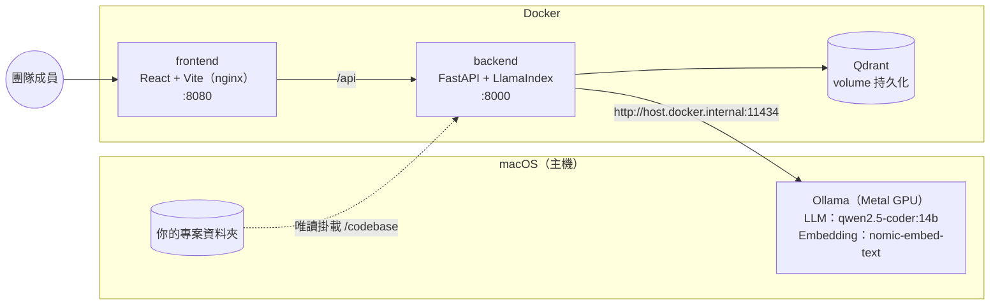

# local-codebase-rag

[](https://github.com/alelcold/local-codebase-rag/actions/workflows/ci.yml)

地端版的 Codebase RAG 系統：讓團隊用自然語言查詢遊戲前端專案的程式碼（適合約 50–300 個檔案的專案）。
所有資料與模型都在本機執行，程式碼不會離開你的電腦。

回答會附上引用的**檔案路徑與行號**，例如 `src/entities/Player.ts:16-113`，點開即可看到對應的程式碼。



## 目錄

- [硬體需求](#硬體需求)
- [為什麼 Ollama 不放在 Docker 裡](#為什麼-ollama-不放在-docker-裡)
- [安裝步驟](#安裝步驟)
- [如何索引專案](#如何索引專案)
- [如何查詢](#如何查詢)
- [設定](#設定)
- [常見問題](#常見問題)
- [在 GitHub Codespaces 測試](#在-github-codespaces-測試)
- [開發與測試](#開發與測試)
- [專案結構](#專案結構)
- [文件導覽](#文件導覽)

## 硬體需求

| 項目 | 建議 | 說明 |
| --- | --- | --- |
| 電腦 | Apple Silicon Mac（M2 以上） | 本專案以 Mac M2、32GB RAM 為目標環境 |
| 記憶體 | 32GB | `qwen2.5-coder:14b`（Q4）加上 16K 上下文約佔 12–13GB 統一記憶體；embedding 模型約 0.3GB；Docker（Qdrant + 後端）約 1–2GB |
| 磁碟 | 15GB 以上可用空間 | 14b 模型約 9GB、embedding 模型約 0.3GB、Docker 映像約 1.5GB，向量資料通常不到 100MB |
| 軟體 | macOS 13+、[Ollama](https://ollama.com/download)、[Docker Desktop](https://www.docker.com/products/docker-desktop/)（含 Compose v2） | |

記憶體較少（例如 16GB）時，建議把 `LLM_MODEL` 改成 `qwen2.5-coder:7b`，並把 `LLM_NUM_CTX` 降到 `8192`。

Docker Desktop 不需要分配很多記憶體（預設值即可），因為最吃記憶體的模型是跑在 macOS 上，不在 Docker 的 VM 裡。

## 為什麼 Ollama 不放在 Docker 裡

**一句話：Docker 裡的 Ollama 用不到 Mac 的 GPU。**

1. **Docker 在 macOS 上是跑在 Linux 虛擬機裡**，容器看不到 Apple 的 Metal GPU。Ollama 在容器內只能用 CPU 推論，14b 模型的生成速度會慢好幾倍，查詢一次可能要等好幾分鐘。直接安裝在 macOS 上的 Ollama 會自動使用 Metal 加速。
2. **記憶體配置更有效率**。Apple Silicon 是 CPU/GPU 共用的統一記憶體。如果模型放在 Docker VM 裡，就得先把一大塊記憶體固定劃給 VM；原生執行時，macOS 可以依實際需要動態分配。
3. **模型檔只需要下載一次**。原生 Ollama 的模型存在 `~/.ollama`，其他工具（例如 IDE 外掛、終端機 `ollama run`）也能共用，重建容器也不會重新下載 9GB 的模型。

因此架構上把「需要 GPU 的部分」（Ollama）放在主機，「容易打包的部分」（Qdrant、後端、前端）放在 Docker。
容器透過 Docker Desktop 提供的 `host.docker.internal` 連到主機的 Ollama（`http://host.docker.internal:11434`）。

## 安裝步驟

### 1. 安裝 Ollama 與 Docker Desktop

```bash
brew install ollama
```

或從 <https://ollama.com/download> 下載 macOS App（安裝後開啟一次，它會常駐在選單列）。
Docker Desktop 請從 <https://www.docker.com/products/docker-desktop/> 下載安裝並啟動。

### 2. 取得本專案並設定

```bash
git clone https://github.com/alelcold/local-codebase-rag.git
```

```bash
cd local-codebase-rag
```

```bash
cp .env.example .env
```

編輯 `.env`，把 `PROJECT_PATH` 改成要索引的專案路徑（第一次想先試流程的話可以保留預設的範例專案）：

```dotenv
PROJECT_PATH=/Users/you/work/my-game-frontend
```

### 3. 執行安裝腳本

```bash
./scripts/setup.sh --index
```

這個腳本會依序：

1. 確認 Ollama 已安裝；沒有在執行的話會試著啟動它
2. 拉取 `LLM_MODEL` 與 `EMBED_MODEL`（已存在就略過；第一次下載 14b 模型需要一段時間）
3. 確認 Docker 正在執行、`PROJECT_PATH` 存在
4. `docker compose up -d --build` 啟動 Qdrant、後端、前端
5. 等後端健康檢查通過
6. （加上 `--index` 時）建立索引

其他參數：`--skip-pull`（不檢查模型）、`--no-build`（不重新 build 映像）、`--help`。

### 4. 開始使用

打開 <http://localhost:8080>，右上角的狀態標籤是綠色就表示 Ollama、Qdrant 都正常。

### 先用範例專案測試流程

`examples/sample-game-frontend/` 是一個小型的遊戲前端專案（約 20 個檔案，TypeScript + React + Markdown 文件），
`.env` 的預設值就是它。執行 `./scripts/setup.sh --index` 之後，可以在介面上試著問：

- 玩家受傷後的無敵時間在哪裡設定？
- 分數和連擊倍率是怎麼計算的？
- 遊戲主迴圈的流程是什麼？
- 小行星的生成頻率怎麼隨關卡變化？

確認流程沒問題後，再把 `PROJECT_PATH` 改成你的專案（見下方「換成自己的專案」）。

## 如何索引專案

### 執行索引

三種方式效果相同，擇一即可：

| 方式 | 增量索引 | 完整重建 |
| --- | --- | --- |
| 網頁介面 | 按「更新索引」 | 按「完整重建」 |
| 命令列（會即時顯示每個檔案的進度） | `./scripts/index.sh` | `./scripts/index.sh --full` |
| API | `curl -X POST localhost:8000/index` | `curl -X POST localhost:8000/index -H 'Content-Type: application/json' -d '{"full": true}'` |

- **增量索引**（預設）：只處理新增、修改、刪除的檔案。每個檔案的內容雜湊值存在 Qdrant 裡，沒變的檔案會直接略過，不會重新呼叫 embedding 模型。專案改動後隨時執行即可，幾秒內就會完成。
- **完整重建**：清空目前的 collection 後重新處理所有檔案。一般不需要；當你懷疑索引有問題時再用。

**修改切塊或 embedding 內容的設定後，需要重新索引，而且會自動全量重建。** 每個片段都記錄了建立索引時的設定（`index_config`：切塊器版本、embedding 內容格式、`CHUNK_MAX_CHARS`、`EMBED_MODEL`、文件前綴、`CHUNK_METADATA`）。執行 `./scripts/index.sh`（或介面上的「更新索引」、`POST /index`）時，若目前設定與索引中記錄的不同，索引器會清空 collection 並全部重建，同時印出原因：

```text
Index settings changed, rebuilding everything.
  was: chunker=1;embed_format=2;chunk_max_chars=3000;embed_model=nomic-embed-text;doc_prefix='search_document: ';chunk_metadata=off
  now: chunker=1;embed_format=2;chunk_max_chars=3000;embed_model=nomic-embed-text;doc_prefix='search_document: ';chunk_metadata=on
```

- 會觸發重建的設定：`CHUNK_METADATA`、`CHUNK_MAX_CHARS`、`EMBED_DOC_PREFIX`，以及程式更新了切塊或 embedding 內容格式時。改了設定還沒重新索引時，`/health` 的 `qdrant.reindex_needed` 會是 `true`，`scripts/evaluate.py` 也會提醒。
- **從舊版升級後，第一次索引會全量重建一次**，因為舊版建立的片段沒有 `index_config`。
- 只影響查詢的設定（`HYBRID_SEARCH`、`SPLIT_RETRIEVAL`、`DOC_TOP_K`、`RRF_K`、`PROMPT_VARIANT`、`TOP_K`）不需要重新索引，重新啟動 backend 即可。
- 更換 `EMBED_MODEL` 會自動改用另一個 collection（例如 `codebase_mxbai_embed_large`），在新的 collection 裡建立索引。

API 的 `/index` 預設在背景執行並立即回傳，可用 `GET /index/status` 查看進度；若要等待完成再回傳，加上 `"wait": true`。

### 會索引哪些檔案

- 副檔名：預設 `.ts .tsx .js .jsx .mjs .cjs .md`（`INDEX_EXTENSIONS`）
- 略過的資料夾：`node_modules`、`.git`、`dist`、`build`、`coverage`、`.next` 等（`EXCLUDE_DIRS`）
- 略過的檔名：`*.min.js`、`*.map`、`*.d.ts`、`package-lock.json` 等（`EXCLUDE_PATTERNS`）
- 超過 500KB 的檔案會略過（`MAX_FILE_BYTES`），通常是打包產物或自動產生的資料

專案以**唯讀**方式掛載到容器的 `/codebase`，索引器不會修改你的任何檔案。

### 切塊方式

| 檔案類型 | 切法 |
| --- | --- |
| `.ts` `.tsx` `.js` `.jsx` `.mjs` `.cjs` | 用 tree-sitter 解析語法樹，每個頂層 function、class、interface、type、enum、`const X = () => …` 元件各成一塊；上方的 JSDoc 註解會跟著同一塊。`import` 與其他頂層敘述合併成 module 區塊。超過 `CHUNK_MAX_CHARS` 的 class 會再依 method 切開（`Game.update`、`Game.render`…） |
| `.md` | 依標題（`#`～`######`）切成章節，程式碼區塊裡的 `#` 不會被當成標題；每塊會記錄標題路徑，例如 `玩法規則 > 計分` |
| 其他（若加入 `INDEX_EXTENSIONS`） | 依固定行數切塊 |

每一塊都保留原始的起訖行號；送進 embedding 模型時會加上「檔案路徑＋符號名稱」的標頭，讓「Player 的 jump 在哪」這類問題更容易命中。

每一塊也會記錄它**定義**與 **export** 的名稱（頂層的 `const`／`function`／`class`…，以及 class 的 method），存在 Qdrant 的 payload，供混合檢索比對識別字。設定 `CHUNK_METADATA=true` 時，這些資訊也會放進 embedding 的標頭，例如 `gameConfig.ts` 的片段會變成：

```text
File: src/config/gameConfig.ts
Type: code (typescript)
Defines: FIXED_DT, MAX_FRAME_TIME, …, INVINCIBLE_MS, …
Exports: FIXED_DT, MAX_FRAME_TIME, …, INVINCIBLE_MS, …
```

method 片段還會加上所屬的 class（`Class: Player`）。切換這個設定後要重新索引（會自動全量重建，見上方）。

### 換成自己的專案

1. 修改 `.env` 的 `PROJECT_PATH`
2. 如果之後還想保留其他專案的索引，順便設定 `QDRANT_COLLECTION=my_game`（每個專案用不同名稱）
3. 重新建立後端容器讓新的掛載生效，然後建立索引：

```bash
docker compose up -d
```

```bash
./scripts/index.sh
```

若沒有設定不同的 `QDRANT_COLLECTION`，舊專案的檔案會在這次增量索引中被視為「已刪除」並從索引移除。

## 如何查詢

### 網頁介面

在 <http://localhost:8080> 輸入問題，按「送出」或 ⌘/Ctrl + Enter。

- 回答以串流方式顯示：檢索完成後先列出**引用的檔案**，模型開始產生後再**逐字顯示**回答，結束後顯示**首字延遲**與**總耗時**。生成中可以按「停止」
- 連線在回答傳完前中斷時，已收到的內容會保留在畫面上，並說明可能原因
- 回答中的 `[1]`、`[2]` 可以點擊，會捲到對應的引用片段並展開
- 每個引用片段顯示 `檔案路徑:起始行-結束行`、符號名稱（函式或 class）與相似度分數，展開後可看到帶行號的程式碼
- 「參考片段」可以調整要給模型看幾段程式碼（預設為 `.env` 的 `TOP_K`，一般是 8）。問題範圍較大時調高，模型回答會比較完整，但會稍慢

第一次查詢需要把模型載入記憶體，可能要 20–60 秒；之後模型會常駐 `OLLAMA_KEEP_ALIVE`（預設 30 分鐘），查詢通常在十幾秒內完成，實際速度視機型（M2 / Pro / Max）與回答長度而定。

### 提問技巧

- 直接提到你知道的名稱效果最好：「`ScoreSystem` 的連擊什麼時候歸零？」
- 問「在哪裡」「怎麼運作」「流程是什麼」這類問題最適合；需要全專案統計的問題（例如「總共有幾個元件」）不適合 RAG，因為模型只看得到取回的片段
- 回答只根據取回的程式碼產生。如果回答說找不到，可以換個說法、提高參考片段數，或確認檔案有被索引
- 中英文提問都可以，模型會用提問的語言回答

### API

後端 API 文件（Swagger）：<http://localhost:8000/docs>

```bash
curl -s localhost:8000/query -H 'Content-Type: application/json' \
  -d '{"question": "玩家受傷後的無敵時間在哪裡設定？", "top_k": 6}'
```

回應格式：

```json
{
  "answer": "無敵時間由 INVINCIBLE_MS 控制（1500 毫秒）[1]，在 Player.takeDamage 中設定 [2]……",
  "sources": [
    {
      "ref": 1,
      "file_path": "src/config/gameConfig.ts",
      "start_line": 1,
      "end_line": 26,
      "symbol": "",
      "kind": "module",
      "language": "typescript",
      "score": 0.71,
      "text": "/** Fixed simulation step, in seconds. */\n..."
    }
  ]
}
```

| 端點 | 說明 |
| --- | --- |
| `GET /health` | Ollama（含所需模型是否已下載）與 Qdrant 的狀態、目前索引的片段數 |
| `POST /index` | 開始索引。body：`{"full": false, "wait": false}`；已有索引在執行時回傳 409 |
| `GET /index/status` | 最近一次索引的狀態、進度與結果（新增／更新／刪除的檔案、錯誤） |
| `POST /query` | body：`{"question": "...", "top_k": 8}`；回傳回答與引用來源 |
| `POST /query/stream` | body 同上；以 Server-Sent Events 串流回傳（見下方） |

#### 串流查詢（`/query/stream`）

介面使用這個端點。回應是 `text/event-stream`，事件依序為：

| 事件 | 內容 |
| --- | --- |
| `heartbeat` | 一開始先送一次，之後每 `STREAM_HEARTBEAT_SECONDS` 秒（預設 10）沒有其他資料時再送，讓代理知道連線還在使用：`{"elapsed_seconds": 12.0}` |
| `sources` | 檢索完成後馬上送出，格式與 `/query` 的 `sources` 相同 |
| `token` | 回答的一小段文字：`{"text": "..."}` |
| `done` | 結束與耗時統計：`retrieval_seconds`、`first_token_seconds`、`total_seconds`、`tokens`、`answer_chars` |
| `error` | 串流開始後才失敗時送出（HTTP 狀態已是 200）：`{"kind": "timeout" 或 "error", "detail": "..."}` |

```bash
curl -sS -N localhost:8080/api/query/stream -H 'Content-Type: application/json' \
  -d '{"question": "玩家受傷後的無敵時間在哪裡設定？"}'
```

```text
event: heartbeat
data: {"elapsed_seconds": 0.0}

event: sources
data: [{"ref": 1, "file_path": "src/config/gameConfig.ts", "start_line": 1, "end_line": 26, ...}]

event: token
data: {"text": "無敵"}

...

event: done
data: {"retrieval_seconds": 0.21, "first_token_seconds": 3.4, "total_seconds": 9.8, "tokens": 87, "answer_chars": 152}
```

（上面的數字只是格式示意，不是量測結果。）設計考量見 [ADR 0010](docs/decisions/0010-streaming-responses.md)。

## 設定

所有設定都在 `.env`，完整清單與說明請見 [`.env.example`](.env.example)。最常調整的幾項：

| 變數 | 預設值 | 說明 |
| --- | --- | --- |
| `PROJECT_PATH` | `./examples/sample-game-frontend` | 要索引的專案（主機路徑，唯讀掛載） |
| `LLM_MODEL` | `qwen2.5-coder:14b` | 回答用的模型 |
| `EMBED_MODEL` | `nomic-embed-text` | 向量化模型 |
| `LLM_NUM_CTX` | `16384` | LLM 上下文長度；太小會截斷引用的程式碼 |
| `TOP_K` | `8` | 預設取回的片段數 |
| `HYBRID_SEARCH` | `false` | 混合檢索：向量 + BM25 + 識別字定義比對，以 RRF 合併（[ADR 0013](docs/decisions/0013-hybrid-retrieval-and-split-retrieval.md)） |
| `SPLIT_RETRIEVAL` / `DOC_TOP_K` | `false` / `1` | 程式碼與文件分開取回：文件最多 `DOC_TOP_K` 段，其餘給程式碼 |
| `CHUNK_METADATA` | `false` | 把路徑、類型、符號、定義／export 的名稱放進 embedding 內容（**需重新索引**，會自動全量重建） |
| `PROMPT_VARIANT` | `v1` | `v2` = 一律繁體中文回答，並先說明程式碼位置（檔案與行號） |
| `LLM_REQUEST_TIMEOUT` | `300` | 後端等待 Ollama 生成回答的秒數 |
| `EMBED_REQUEST_TIMEOUT` | `300` | 後端等待 Ollama 產生向量（embedding）的秒數 |
| `PROXY_READ_TIMEOUT` / `PROXY_SEND_TIMEOUT` | `300` / `300` | 前端 nginx 代理 `/api` 時等待後端的秒數；改了只要 `docker compose up -d`，不用重新 build |
| `STREAM_HEARTBEAT_SECONDS` | `10` | 串流查詢沒有其他資料時，每隔幾秒送一次 heartbeat |
| `FRONTEND_PORT` / `FRONTEND_BIND` | `8080` / `127.0.0.1` | 前端連接埠；改成 `0.0.0.0` 開放區網存取 |

修改 `.env` 後執行 `docker compose up -d` 讓設定生效（會重新建立有變更的容器）。改了模型名稱記得先 `ollama pull`，或重新執行 `./scripts/setup.sh`。

## 常見問題

### 右上角顯示「Ollama 無法連線」

1. 確認 Ollama 在 Mac 上有執行：

   ```bash
   curl http://localhost:11434/api/version
   ```

2. 確認容器連得到主機的 Ollama：

   ```bash
   docker compose exec backend python -c "import urllib.request; print(urllib.request.urlopen('http://host.docker.internal:11434/api/version').read())"
   ```

3. 使用 Docker Desktop 時，Ollama 預設只監聽 `127.0.0.1` 也能連到。如果你用的是 **Colima、OrbStack 或其他 Docker 實作**而連不到，請讓 Ollama 監聽所有網卡後重新啟動 Ollama：

   ```bash
   launchctl setenv OLLAMA_HOST 0.0.0.0
   ```

   這樣會讓同一個網路上的其他機器也能存取 Ollama，請只在可信任的網路使用。

### 顯示「缺少模型」

`.env` 中的模型還沒下載。執行 `ollama pull <模型名稱>`，或重新執行 `./scripts/setup.sh`。可用 `ollama list` 查看已下載的模型。

### 第一次查詢很慢，或查詢逾時（504）

第一次查詢要把約 9GB 的模型載入記憶體，屬正常現象。之後模型會常駐 `OLLAMA_KEEP_ALIVE` 設定的時間。
等待時，介面會顯示「生成中」與已等待秒數；逾時時會說明是哪一段先放棄，並列出可能原因。

一次查詢會經過好幾段連線，每一段都有自己的逾時：

```text
瀏覽器 →（Codespaces 等連接埠轉發）→ nginx → 後端 → Ollama
                                   PROXY_READ_TIMEOUT   LLM_REQUEST_TIMEOUT / EMBED_REQUEST_TIMEOUT
```

- **錯誤訊息寫著「Ollama 生成回答逾時…（LLM_REQUEST_TIMEOUT）」**：後端等不到模型。調高 `.env` 的 `LLM_REQUEST_TIMEOUT`（embedding 階段則是 `EMBED_REQUEST_TIMEOUT`）。
- **只顯示 `504 Gateway Timeout`**：是 nginx 或更前面的代理先放棄。調高 `PROXY_READ_TIMEOUT`，並讓它比 `LLM_REQUEST_TIMEOUT` 稍大（例如 330 / 300），後端才會先逾時並回傳具體原因。
- 調整後執行 `docker compose up -d` 即可生效。
- **透過 Codespaces 等轉發／反向代理連線**：它們有自己的上限，調高上面的值也沒用。介面使用的串流查詢（`/query/stream`）會持續送出資料來避開閒置上限；若仍被中斷，執行 `./scripts/doctor.sh` 檢查各服務，並用 `curl -N` 直接呼叫後端比較。
- 根本的解法是讓查詢變快：改用 `qwen2.5-coder:7b`（或只有 CPU 時改用 `3b`）、降低 `LLM_NUM_CTX`、或降低參考片段數。
- 可在另一個終端機執行 `ollama ps`，確認模型是否已載入，以及是否 100% 在 GPU 上執行。

設計考量見 [ADR 0009](docs/decisions/0009-timeout-settings.md) 與 [ADR 0010](docs/decisions/0010-streaming-responses.md)。

### Mac 變得很卡、記憶體壓力很高

把 `LLM_MODEL` 改成 `qwen2.5-coder:7b`，`LLM_NUM_CTX` 降到 `8192`，或把 `OLLAMA_KEEP_ALIVE` 設短一點（例如 `5m`）讓模型閒置時釋放記憶體。

### 回答不準確，或說找不到相關程式碼

- 確認索引是最新的（執行一次增量索引，結果會顯示新增/更新了哪些檔案）
- 展開引用片段，看取回的程式碼是否相關。如果不相關，換個說法或直接提到函式/class 名稱
- 提高「參考片段」數量
- 「在哪裡設定」類的問題只引用到文件、沒有引用程式碼時，試試 `SPLIT_RETRIEVAL=true`（限制文件名額）與 `HYBRID_SEARCH=true`（問題中直接寫出識別字，例如 `INVINCIBLE_MS`、`ScoreSystem`，會精準命中定義它的程式碼）；`CHUNK_METADATA=true` 需要重新索引。逐項比較的方法見 [實驗計畫](docs/evaluation/experiment-plan-retrieval.md)
- 確認相關檔案的副檔名在 `INDEX_EXTENSIONS` 內，且沒有被 `EXCLUDE_DIRS` / `EXCLUDE_PATTERNS` / `MAX_FILE_BYTES` 排除（索引結果會列出因檔案過大而略過的檔案）
- 可以試試其他 embedding 模型，例如 `EMBED_MODEL=mxbai-embed-large`（`ollama pull` 後執行一次索引即可，會自動使用新的 collection）

### 某些檔案索引失敗

索引結果會列出失敗的檔案與原因，其他檔案不受影響。常見原因是索引過程中 Ollama 被關閉或逾時。
失敗的檔案會保留舊版的索引內容，下次執行增量索引時會自動重試。

### 專案改動後需要重新索引嗎？

需要，但只要執行增量索引（介面上的「更新索引」或 `./scripts/index.sh`），只會處理有變更的檔案。
改了切塊或 embedding 相關的設定（例如 `CHUNK_METADATA`）時，同一個指令會偵測到並自動全量重建，見[執行索引](#執行索引)。
也可以排程自動執行，例如在 crontab 每小時觸發一次：

```bash
curl -sS -X POST localhost:8000/index > /dev/null
```

### 掛載的專案路徑在容器裡是空的

Docker Desktop 只能掛載「Settings → Resources → File sharing」中允許的路徑（預設包含 `/Users`）。
專案放在外接硬碟或其他位置時，請先加入 File sharing，再執行 `docker compose up -d`。

### 讓團隊成員從其他電腦使用

在 `.env` 設定 `FRONTEND_BIND=0.0.0.0` 後執行 `docker compose up -d`，其他人就能用 `http://<你的 Mac 的 IP>:8080` 連線。
本系統沒有登入機制，任何能連到這個連接埠的人都能查詢程式碼，請只在公司內網等可信任的網路開放。
後端 API（8000）與 Qdrant（6333）一律只綁定本機。

### 連接埠被占用

修改 `.env` 的 `FRONTEND_PORT`、`BACKEND_PORT` 或 `QDRANT_PORT`，然後 `docker compose up -d`。

### 如何清除所有索引資料

```bash
docker compose down -v
```

`-v` 會刪除 Qdrant 的 volume。下次啟動後執行索引即可重建。只想重建索引而不刪除 volume 的話，用 `./scripts/index.sh --full`。

### 停止與更新

```bash
docker compose down
```

```bash
git pull && docker compose up -d --build
```

## 在 GitHub Codespaces 測試

部署到 Mac 之前，可以先在 GitHub Codespaces（Linux、沒有 GPU）跑一次完整流程，確認索引、檢索、引用與介面都正常。只有 CPU，所以這裡的速度與回答品質**不代表**正式環境（見 [ADR 0007](docs/decisions/0007-multi-environment-testing-strategy.md)）。

### 開啟即可使用

1. 在 GitHub 的 repo 頁面按 **Code → Codespaces → Create codespace on main**。建議使用 **4-core** 機型（[`.devcontainer/devcontainer.json`](.devcontainer/devcontainer.json) 的 `hostRequirements` 會預先選好）。
2. 等待自動設定完成，不用輸入任何指令。第一次約需數分鐘（{待填：實測時間}），可以在終端機的 Creation log 看到進度：
   - **建立時**（`postCreateCommand`，只執行一次）：安裝 Ollama 與 `jq`；沒有 `.env` 時，從 [`.env.codespaces`](.env.codespaces) 建立（`qwen2.5-coder:3b`、`TOP_K=4`、範例專案）。
   - **每次啟動時**（`postStartCommand`，停止後重開也會執行）：以 `OLLAMA_HOST=0.0.0.0` 在背景啟動 Ollama、等待就緒、拉取缺少的模型、`docker compose up -d --build`、沒有索引時自動建立索引，最後執行 [`scripts/doctor.sh`](scripts/doctor.sh) 並印出網址。
3. 右下角跳出 8080（**Frontend（查詢介面）**）的通知時，按 **Open in Browser**；或從 **Ports** 面板開啟 8080。

設定完成後，提問時會先顯示引用的檔案，再逐字顯示回答，回答下方有首字延遲與總耗時。回答以串流傳送（[ADR 0010](docs/decisions/0010-streaming-responses.md)），連線上至少每 10 秒就有資料，用來避開 Codespaces 轉發在約 100 秒時切斷沒有回應的請求（{待填：在 Codespaces 實測確認}）。

說明：

- `docker compose` 指令在 codespace 裡會自動套用 [`docker-compose.codespaces.yml`](docker-compose.codespaces.yml)（`devcontainer.json` 設定了 `COMPOSE_FILE`），不需要手寫 override。Mac 與 EC2 不受影響。
- 模型存放在 repo 內的 `.ollama/`（已加入 `.gitignore`），重建容器時不用重新下載。
- **11434（Ollama）不會被轉發**，請不要手動轉發或設為 public（Ollama 沒有驗證機制）。
- 設定流程的輸出會附加到 `.logs/post-start.log`；Ollama 的 log 在 `.logs/ollama.log`。
- 想重新執行整個啟動流程：`bash .devcontainer/post-start.sh`

### 出問題時：`scripts/doctor.sh`

```bash
./scripts/doctor.sh
```

依序檢查下列項目，失敗時會直接印出修正指令；依賴失敗項目的檢查會略過，從第一個 ✗ 開始修正即可：

| # | 檢查 | 對應的踩坑 |
| --- | --- | --- |
| 1–3 | Ollama 已安裝、程序在執行、API 有回應（用 `curl -sS`，錯誤不會被藏起來） | 前景執行卡住終端機、重開 codespace 後程序消失、`curl -s` 看不到錯誤 |
| 4 | 監聽位址是 `0.0.0.0`（Linux）；只聽 `127.0.0.1` 時容器連不到 | Ollama 只監聽 `127.0.0.1` |
| 5 | `.env` 指定的模型都已下載 | 缺少模型 |
| 6–7 | Docker 在執行、`qdrant`／`backend`／`frontend` 都在執行 | |
| 8 | **從 backend 容器**呼叫 `host.docker.internal:11434` | 在主機上測試成功，不代表容器連得到 |
| 9–10 | 後端 `/health`、前端與 nginx 的 `/api` 代理 | |
| 11 | Qdrant 已有索引 | |

在 Mac 上也能執行（使用 bash 3.2、`lsof`；macOS 上 Ollama 聽 `127.0.0.1` 是正常的）。

### 附錄：手動步驟

不使用 dev container（例如在其他 Linux 機器上）時，可以手動完成同樣的流程：

1. 安裝 Ollama 並在背景啟動，**監聽 `0.0.0.0`**（Linux 上容器是從 Docker bridge 連過來的，連不到 `127.0.0.1`）：

   ```bash
   curl -fsSL https://ollama.com/install.sh | sh
   ```

   ```bash
   mkdir -p .logs && OLLAMA_HOST=0.0.0.0 nohup ollama serve >> .logs/ollama.log 2>&1 &
   ```

2. 建立 `.env`（小模型、`TOP_K=4`、逾時設定）：

   ```bash
   cp .env.codespaces .env
   ```

3. 讓 `docker compose` 套用 Linux 用的 override：

   ```bash
   export COMPOSE_FILE=docker-compose.yml:docker-compose.codespaces.yml
   ```

4. 拉模型、啟動並建立索引：

   ```bash
   ./scripts/setup.sh --index
   ```

5. 從 Ports 面板開啟 8080。**11434 埠請維持 private**。

6. 確認一切正常：

   ```bash
   ./scripts/doctor.sh
   ```

停止後再開啟 codespace 時，背景程序都會消失，需要重做第 1 步（dev container 會自動處理）。

常見的坑（`scripts/doctor.sh` 會自動檢查大部分項目）：

| 症狀 | 原因 | 解法 |
| --- | --- | --- |
| `/health` 顯示 Ollama 無法連線，但在終端機 `curl localhost:11434` 是通的 | Ollama 只監聽 `127.0.0.1`；容器的連線來自 bridge gateway | 用 `OLLAMA_HOST=0.0.0.0` 啟動 Ollama。compose 已經有 `extra_hosts: host.docker.internal:host-gateway` |
| 啟動 `ollama serve` 後，終端機看起來卡住 | 常駐程式在前景執行，會一直佔住終端機 | 指令結尾加 `&` 放到背景，輸出導到 log |
| 重新啟動後，log 裡找不到 `Listening` | `>` 會清空檔案，第二次啟動把第一次的紀錄蓋掉了 | 改用 `>>`；重新啟動前先用 `ss -ltnp \| grep 11434` 確認是否已經在跑 |
| `curl -s` 什麼都沒印，看不出哪裡出錯 | `-s` 會連錯誤訊息一起隱藏 | 改用 `curl -sS`，需要時加上 `-w '%{http_code}\n'` |
| 不確定容器到底連不連得到 Ollama | 主機上測試成功，不代表容器也連得到 | 從容器裡測試（見下方指令） |
| 重開 codespace 後介面顯示 Ollama 無法連線 | 停止 codespace 時背景程序會消失 | dev container 每次啟動都會重新啟動 Ollama；手動流程請重做第 1 步 |
| 透過轉發網址查詢，約 100 秒後回傳 504，但在 codespace 內 `curl` 會成功 | Codespaces 轉發有自己的上限，nginx 與後端的逾時設定管不到 | 介面已改用串流（[ADR 0010](docs/decisions/0010-streaming-responses.md)）；見[第一次查詢很慢，或查詢逾時（504）](#第一次查詢很慢或查詢逾時504) |

從容器的角度驗證網路，這是最直接的方法：

```bash
docker run --rm --add-host=host.docker.internal:host-gateway curlimages/curl -sS http://host.docker.internal:11434/api/version
```

完整紀錄見 [devlog 2026-11-01](docs/devlog/2026-11-01.md)、[Codespaces 環境建置](docs/devlog/2026-11-01-codespace-setup.md) 與 [devlog 2026-11-02](docs/devlog/2026-11-02.md)；dev container 的設計見 [ADR 0011](docs/decisions/0011-devcontainer-for-codespaces.md)。

## 開發與測試

### 後端單元測試

測試不需要 Ollama、Qdrant 或 Docker：Ollama 以假的 embedding / LLM 與 mock 的 HTTP transport 取代，Qdrant 使用 qdrant-client 的記憶體模式（`:memory:`）。

```bash
cd backend
```

```bash
python3 -m venv .venv && source .venv/bin/activate
```

```bash
pip install -r requirements-dev.txt
```

```bash
pytest
```

涵蓋範圍：切塊（TS/TSX/JS/Markdown、行號正確性、大型 class 依 method 切分）、增量索引（新增/修改/刪除/未變更、設定變更、embedding 失敗時保留舊資料）、檢索與提示詞組成、API（`/health`、`/index`、`/index/status`、`/query` 的正常與錯誤情況，包含 Ollama 逾時時回傳 504）、串流查詢（`/query/stream` 的事件順序、heartbeat、串流中的逾時與錯誤事件）、評估腳本（`questions.yaml` 與範例專案一致、各項指標的計算、以假的 SSE 後端跑完整流程、`compare.py` 差異表）、設定。

### 持續整合（GitHub Actions）

[`.github/workflows/ci.yml`](.github/workflows/ci.yml) 在每次 push 與 PR 時執行：

| Job | 時機 | 內容 |
| --- | --- | --- |
| Backend unit tests | 每次 push／PR | `pytest`（Ollama、Qdrant 皆以假物件取代） |
| Compose config | 每次 push／PR | `docker compose config -q`：主檔，以及主檔搭配每個 `docker-compose.*.yml` override |
| Build image | 每次 push／PR | build `backend`、`frontend` 映像檔 |
| End-to-end smoke test | 對 `main` 的 PR | 在 runner 上安裝 Ollama（`OLLAMA_HOST=0.0.0.0`），使用 `qwen2.5-coder:0.5b` + `nomic-embed-text`（有快取），搭配 [`docker-compose.ci.yml`](docker-compose.ci.yml) 啟動服務，索引範例專案、送出一般查詢與串流查詢，確認回應附有檔案引用、串流事件順序正確且沒有被 nginx 緩衝；失敗時輸出各服務的 `docker compose logs` |

冒煙測試只證明「流程能跑通」，不評估回答品質；為什麼用最小模型、為什麼拆成多個 job，見 [ADR 0008](docs/decisions/0008-ci-design.md)。

同一支冒煙測試腳本也可以對本機已啟動的服務執行：

```bash
./scripts/smoke-test.sh
```

### 評估回答品質

[`scripts/evaluate.py`](scripts/evaluate.py) 會透過串流查詢端點，依序詢問 [`docs/evaluation/questions.yaml`](docs/evaluation/questions.yaml) 的 10 題（範例專案），並記錄：

- 每題的首字延遲、總耗時、token 數
- 引用命中：預期的檔案有沒有被取回，程式碼檔與文件檔分開統計；「在哪裡設定」類的題目另外檢查有沒有取回**定義**該設定的程式碼檔
- 關鍵字命中率、回答是否混入簡體字、陷阱題是否正確回答「找不到」

結果寫到 `docs/evaluation/results/<日期>-<label>.json` 與 `.md` 報告。**關鍵字命中不等於回答正確**，報告每題都有空白的「人工判定正確性」欄位，要由人讀過回答後填寫（[ADR 0012](docs/decisions/0012-automated-evaluation-metrics.md)）。

```bash
pip install -r scripts/requirements-eval.txt   # PyYAML；codespace 已預先安裝
```

```bash
python3 scripts/evaluate.py --label codespace-3b-k4
```

```bash
python3 scripts/evaluate.py --label codespace-3b-k8 --top-k 8
```

填好人工欄位後，把分數寫回 JSON，再比較兩次結果：

```bash
python3 scripts/evaluate.py --apply-manual docs/evaluation/results/2026-11-03-codespace-3b-k4.md
```

```bash
python3 scripts/compare.py docs/evaluation/results/2026-11-03-codespace-3b-k4.json docs/evaluation/results/2026-11-03-codespace-3b-k8.json
```

檢索相關開關（混合檢索、分類取回、metadata、提示版本）會由 `/health` 回報，記錄在每份報告開頭，方便比較。逐項比較的組合、指令與預期觀察指標見 [docs/evaluation/experiment-plan-retrieval.md](docs/evaluation/experiment-plan-retrieval.md)；`--questions docs/evaluation/questions-identifiers.yaml` 是直接寫出識別字的 5 題補充題組。

其他參數：`--base-url`（預設 `http://localhost:8080/api`，也可直接連後端 `http://localhost:8000`）、`--only 1,9`（只跑指定題號）、`--lang en`、`--no-warmup`、`--out-dir`。完整說明見 [docs/evaluation/README.md](docs/evaluation/README.md)。只有範例專案的結果可以提交到 repo；評估其他專案時，請用 `--out-dir` 寫到 repo 以外的地方。

### 不用 Docker 開發

```bash
docker compose up -d qdrant
```

```bash
cd backend && QDRANT_URL=http://localhost:6333 OLLAMA_BASE_URL=http://localhost:11434 CODEBASE_PATH=../examples/sample-game-frontend uvicorn app.main:app --reload
```

```bash
cd frontend && npm install && npm run dev
```

前端開發伺服器（<http://localhost:5173>）會把 `/api` 代理到 `http://localhost:8000`。

## 專案結構

```text
.
├── .github/workflows/ci.yml    # CI：單元測試、compose 檢查、映像檔 build、端到端冒煙測試
├── .devcontainer/              # Codespaces：開啟即自動安裝並啟動（devcontainer.json、post-create.sh、post-start.sh）
├── docker-compose.yml          # qdrant / backend / frontend（Ollama 在主機上）
├── docker-compose.ci.yml       # CI 冒煙測試專用的 override
├── docker-compose.codespaces.yml # Codespaces 用的 override（由 COMPOSE_FILE 自動套用）
├── .env.example                # 所有可設定項目與說明
├── .env.codespaces             # Codespaces 用的 .env 範本（3b 模型、TOP_K=4）
├── scripts/
│   ├── setup.sh                # 檢查 Ollama、拉模型、啟動 compose
│   ├── index.sh                # 在容器內執行索引器
│   ├── doctor.sh               # 依序診斷 Ollama、Docker、各服務與索引，列出修正指令
│   ├── smoke-test.sh           # 端到端冒煙測試：健康檢查 → 索引 → 查詢 → 串流查詢 → 檢查引用
│   ├── evaluate.py             # 自動化評估：10 題的延遲、引用命中、關鍵字、簡體字 → JSON + Markdown 報告
│   └── compare.py              # 比較兩份評估結果（不同模型或 TOP_K）
├── backend/                    # FastAPI + LlamaIndex
│   ├── Dockerfile
│   ├── app/
│   │   ├── main.py             # API：/health /index /index/status /query /query/stream
│   │   ├── config.py           # 環境變數設定
│   │   ├── chunker.py          # 依語法結構 / Markdown 標題切塊
│   │   ├── indexer.py          # 增量索引（也可用 python -m app.indexer 執行）
│   │   ├── store.py            # Qdrant 存取
│   │   ├── rag.py              # 檢索與回答（附檔案行號引用）
│   │   ├── retrieval.py        # BM25、識別字比對、RRF、程式碼／文件分類取回（ADR 0013）
│   │   └── services.py         # 建立 Ollama / Qdrant 用戶端、健康檢查
│   └── tests/
├── frontend/                   # React + Vite，build 後由 nginx 提供並代理 /api
│   ├── Dockerfile
│   ├── nginx.conf.template     # nginx 設定（逾時由環境變數帶入；串流路徑關閉緩衝）
│   └── src/
└── examples/
    └── sample-game-frontend/   # 測試用的範例專案
```

## 文件導覽

開發過程中的決策、問題與數據都記錄在 `docs/`，之後可用來寫技術文章與更新履歷。所有文件都是英文在前、繁體中文在後。
The `docs/` folder records decisions, problems and measurements made during development. Every document is in English first, with Traditional Chinese below.

| 文件 / Document | 內容 / Contents |
| --- | --- |
| [CLAUDE.md](CLAUDE.md) | 專案簡介、架構，以及記錄決策與隱私的規則 / Project overview, architecture, rules for recording decisions, privacy rules |
| **開發日誌 / Devlog** | |
| [docs/devlog/TEMPLATE.md](docs/devlog/TEMPLATE.md) | 每日開發日誌範本 / Daily devlog template |
| [docs/devlog/2026-10-30.md](docs/devlog/2026-10-30.md) | 架構設計與雲端建置 / Architecture design and cloud build |
| [docs/devlog/2026-11-01.md](docs/devlog/2026-11-01.md) | Codespaces 流程驗證 / Validating the flow on Codespaces |
| [docs/devlog/2026-11-01-codespace-setup.md](docs/devlog/2026-11-01-codespace-setup.md) | Codespaces 環境建置：踩坑與逾時 / Codespaces setup: pitfalls and timeouts |
| [docs/devlog/2026-11-02.md](docs/devlog/2026-11-02.md) | 串流回答與 Codespaces 的 dev container / Streaming answers and a dev container for Codespaces |
| **架構決策紀錄 / ADRs** | |
| [docs/decisions/TEMPLATE.md](docs/decisions/TEMPLATE.md) | ADR 範本 / ADR template |
| [0001](docs/decisions/0001-on-prem-rag-over-cloud-api.md) | 採用地端 RAG 而非雲端 API / On-prem RAG instead of a cloud API |
| [0002](docs/decisions/0002-ollama-outside-docker-on-mac.md) | Mac 上 Ollama 不放進 Docker / Ollama outside Docker on Mac |
| [0003](docs/decisions/0003-qdrant-vector-database.md) | 向量資料庫選用 Qdrant / Qdrant as the vector database |
| [0004](docs/decisions/0004-chunking-by-file-type.md) | 依檔案類型切塊 / Chunking by file type |
| [0005](docs/decisions/0005-model-selection-and-hardware.md) | 模型選擇與硬體對應 / Model selection and hardware |
| [0006](docs/decisions/0006-multi-environment-deployment.md) | 多環境部署差異 / Multi-environment deployment |
| [0007](docs/decisions/0007-multi-environment-testing-strategy.md) | 多環境測試策略 / Multi-environment testing strategy |
| [0008](docs/decisions/0008-ci-design.md) | CI 設計：拆分 job、冒煙測試用最小模型 / CI design: split jobs, smallest model for the smoke test |
| [0009](docs/decisions/0009-timeout-settings.md) | 逾時設定的取捨 / Timeout settings for slow inference |
| [0010](docs/decisions/0010-streaming-responses.md) | 以 SSE 串流回答 / Streaming answers with Server-Sent Events |
| [0011](docs/decisions/0011-devcontainer-for-codespaces.md) | Codespaces 的 dev container / Dev container for Codespaces |
| [0012](docs/decisions/0012-automated-evaluation-metrics.md) | 自動化評估的指標與限制 / Automated evaluation: metrics and their limits |
| [0013](docs/decisions/0013-hybrid-retrieval-and-split-retrieval.md) | 混合檢索、分類取回、切塊 metadata / Hybrid retrieval, split code/doc retrieval, chunk metadata |
| **學習與評估 / Learning & evaluation** | |
| [docs/learning/knowledge-checklist.md](docs/learning/knowledge-checklist.md) | 20 個主題的解釋、程式碼位置、面試題、自我檢核 / 20 topics: explanation, code pointers, interview questions, self-check |
| [docs/evaluation/questions.md](docs/evaluation/questions.md) | 範例專案的 10 題評估與計分表 / 10 evaluation questions on the sample project, with a score sheet |
| [docs/evaluation/README.md](docs/evaluation/README.md) | 自動化評估的使用方式（`questions.yaml`、`evaluate.py`、`compare.py`）/ How to run the automated evaluation |
| [docs/evaluation/experiment-plan-retrieval.md](docs/evaluation/experiment-plan-retrieval.md) | 檢索改善的實驗計畫：組合、指令、預期指標 / Retrieval experiment plan: runs, commands, expected metrics |
| [docs/metrics.md](docs/metrics.md) | 成本、索引、查詢時間、評估結果、模型比較 / Cost, indexing, latency, evaluation results, model comparison |
| **作品集 / Portfolio** | |
| [docs/portfolio/article-series.md](docs/portfolio/article-series.md) | 5 篇技術文章大綱 / Outlines for 5 technical articles |
| [docs/portfolio/resume.md](docs/portfolio/resume.md) | 履歷條目草稿（中英文）/ Resume bullet drafts (EN and ZH) |
